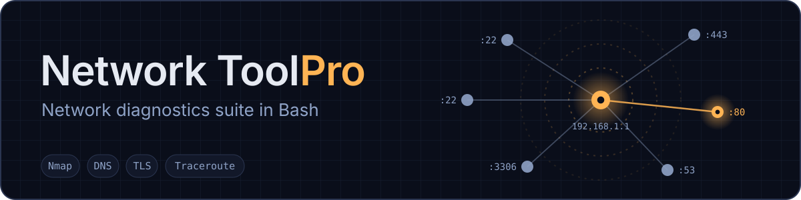

<p align="center">
  
</p>

# Network Tool Pro

[](https://github.com/CMD126/Network_Tool/actions/workflows/ci.yml)


[](LICENSE)

**One Bash command for 20 everyday network checks (ping, DNS, port scans, TLS
certificates, HTTP headers, bandwidth) with an interactive menu for people and
a `--json` CLI for scripts and automation.**

**Status:** version 4.0. CI runs on Ubuntu only; the macOS/BSD code paths are
not exercised by CI.

## Contents

- [Principles](#principles)
- [Install and run](#install-and-run)
- [Using it](#using-it)
- [Architecture](#architecture)
- [Development](#development)
- [Limits of this version](#limits-of-this-version)
- [Responsible use](#responsible-use)
- [License](#license)
- [Reference](#reference): features, requirements, menu, configuration, what's new in v4.0, bug fixes from v3.0, version history

### Demo


Real output, recorded with [`docs/demo.sh`](docs/demo.sh) against this machine
only (127.0.0.1 and a throwaway local web server) and rendered to SVG by
[`docs/render_svg.py`](docs/render_svg.py); the plain-text transcript is in
[`docs/demo.txt`](docs/demo.txt). The last two commands show the safety checks:
a shell-injection attempt is rejected as an invalid host, and a scan of a public
IP is refused before any packet is sent.

## Principles

- **Faster troubleshooting.** Instead of remembering the right flags for
  `ping`, `dig`, `nmap`, `openssl`, `curl`, `ss` and friends on each OS, you
  pick a menu item or one flag and get a readable answer.
- **Automation-ready.** Every check is also a CLI flag. With `--json`, stdout is
  one JSON object per result, so it can feed `jq`, monitoring or CI jobs.
- **Validate every target.** Strict validators for IPs (v4/v6), domains, CIDRs,
  URLs, port lists and interface names run before a value reaches a command.
  Targets are always passed as single quoted arguments, never through `eval`.
  See [SECURITY.md](SECURITY.md).
- **No hidden code in numbers.** Untrusted numbers are checked before they reach
  bash arithmetic, which would otherwise execute `$(...)` hidden in a value.
- **Consent before scanning.** Port and service scans of an address that is not
  private or local are refused unless you confirm (`[y/N]` prompt, or `--yes` on
  the CLI). The vulnerability check always requires explicit consent.
- **One abstraction for OS differences.** `ip` vs `ifconfig`, `ss` vs `netstat`,
  ping flags and `/sys` vs `netstat -ib` live behind
  [lib/platform.sh](lib/platform.sh).
- **Tested and linted.** 56 [bats](https://github.com/bats-core/bats-core)
  tests (including end-to-end checks that `--json` output parses as JSON and
  regression tests for each input-validation fix), seven Python XML-parser
  tests, and a dependency-free fallback runner (`tests/run_tests.sh`). CI runs
  ShellCheck at warning level (zero warnings) and the full suite on GitHub
  Actions.

## Install and run

You need `bash` 4+, `curl`, `openssl` and `ping`; `nmap` and a few other tools
are optional. The full list is under [Requirements](#requirements).

```bash
git clone https://github.com/CMD126/Network_Tool.git
cd Network_Tool

# Debian/Ubuntu
sudo apt install nmap traceroute dnsutils iproute2 curl whois openssl python3

# RHEL/CentOS
sudo yum install nmap traceroute bind-utils iproute curl whois openssl python3

# macOS (Homebrew)
brew install nmap whois bash coreutils
```

Run it in place:

```bash
./networktool.sh                          # interactive menu
./networktool.sh --ping 127.0.0.1 --json  # one check, machine-readable
./networktool.sh --help                   # every flag, with examples
sudo ./networktool.sh                     # root: enables SYN scans + OS detection
```

### `make install` (optional)

Installs the script + `lib/` under a prefix and adds a `networktool` command
to your `PATH`, plus a default config file:

```bash
make install                        # installs to /usr/local (needs sudo)
make install PREFIX=$HOME/.local    # per-user install, no sudo
make uninstall
make test                           # run the test suite (bats-core if present, else a plain-shell fallback)
make lint                           # shellcheck, if installed
```

## Using it

### Interactive menu

```bash
./networktool.sh
```

Type a menu number, `help` for usage/examples, or `h` at any target prompt
to pick from your last 10 targets. The numbers are listed in the
[Menu Reference](#menu-reference).

Common workflows:

- **Quick health check:** `1` (Dashboard).
- **Troubleshoot connectivity:** `5` ping the gateway, `6` traceroute to the
  failing host, `8` check that DNS resolves.
- **Inspect a server:** `11` port scan, `12` service/OS fingerprint, `15` SSL
  certificate expiry, `14` HTTP headers.
- **Monitor live traffic:** `20` live bandwidth on the primary interface, `17`
  active connections, `18` listening ports.

### CLI (non-interactive)

Every feature is scriptable:

```bash
./networktool.sh --dashboard
./networktool.sh --ping 8.8.8.8 --count 10
./networktool.sh --traceroute example.com
./networktool.sh --mtu 8.8.8.8
./networktool.sh --dns google.com
./networktool.sh --reverse-dns 8.8.8.8
./networktool.sh --whois example.com
./networktool.sh --port-scan 192.168.1.1 --ports 22,80,443
./networktool.sh --service-scan 192.168.1.1 --ports 1-1000
./networktool.sh --vuln-check 192.168.1.1 --yes
./networktool.sh --http https://example.com --json
./networktool.sh --ssl example.com --port 443
./networktool.sh --geolocate 8.8.8.8
./networktool.sh --interfaces
./networktool.sh --routes
./networktool.sh --discover 192.168.1.0/24
./networktool.sh --connections
./networktool.sh --listening
./networktool.sh --speed-test --quiet
./networktool.sh --live-bandwidth eth0 --samples 5
```

Global flags: `--json`, `--quiet`, `--no-color`, `--count N`, `--ports RANGE`,
`--port N`, `--samples N`, `--interval N`, `--yes`, `-h`/`--help`.

`--vuln-check` and a non-private `--port-scan`/`--service-scan` target always
require explicit consent, interactively via a `[y/N]` prompt, or in CLI mode
via `--yes`. Without it the scan is refused.

The vulnerability check counts structured NSE `state` values of `VULNERABLE`
or `LIKELY VULNERABLE`, one finding per structured vulnerability table. Text-only scripts
without structured states remain visible in the scan output but are not counted.
This is a count of NSE reports, not unique CVEs or independently verified
exploitability. A successful zero count does not establish that a host is secure.
Nmap failures, incomplete runs and malformed XML return an error, not a clean
zero-finding result.

### JSON output

Real output (from [docs/demo.txt](docs/demo.txt)):

```bash
$ ./networktool.sh --http http://127.0.0.1:8080 --json | jq .
{
  "tool": "http_check",
  "target": "http://127.0.0.1:8080",
  "success": true,
  "data": {
    "status_code": "200",
    "time_total": "0.000989s",
    "size_bytes": "6"
  },
  "timestamp": "2026-11-14T20:21:03Z"
}
```

Each result is one JSON object on its own line:
`{"tool", "target", "success", "data", "timestamp"}`. Most checks print one
object; `--live-bandwidth` prints one per sample. Under `--json`, stdout carries
only JSON (raw tool output is suppressed), errors go to stderr, and an invalid
target exits with status 1.

## Architecture

`networktool.sh` is the entry point. It sets defaults, sources every module in
`lib/`, then `main()` runs `detect_os`, `parse_cli_args`, `load_config`,
`init_colors` and `setup`. If a CLI action was given it calls `dispatch_cli`
and exits; otherwise it enters `interactive_main`, the menu loop.

```
networktool.sh         Entry point: defaults, sourcing, setup/cleanup traps, menu loop, main()
lib/utils.sh           OS detection, validators and sanitizer, private-IP check, logging+rotation, config, history, JSON helpers, spinner
lib/ui.sh              Colors, symbols, banner, menu, prompts, help text
lib/platform.sh        Cross-platform command abstraction (Linux vs macOS/BSD)
lib/output.sh          Result stack, view log, export result
lib/network.sh         Dashboard, interfaces, routes, discovery, ping, traceroute, MTU
lib/dns.sh             DNS lookup, reverse DNS, whois
lib/scan.sh            Port scan, service scan, vuln check
lib/web.sh             HTTP check, SSL certificate, geolocation
lib/monitor.sh         Connections, listening ports, speed test, live bandwidth
lib/cli.sh             Non-interactive argument parsing & dispatch
lib/nse_findings.py    Counts structured Nmap NSE findings from XML (used by the vuln check)
config/config.ini.example
tests/                 bats tests, test_nse_findings.py, run_tests.sh fallback runner
docs/                  Demo recording script, transcript, SVGs, SVG renderer
Makefile
```

How the pieces fit:

- **One code path for menu and CLI.** Each menu item calls a feature function
  (`ping_host`, `port_scan`, `ssl_cert`, ...). The CLI flags parsed by
  `parse_cli_args` set `CLI_ACTION` to the name of the same function, and
  `_dispatch_action` calls it. In CLI mode the function reads its input from the
  `CLI_*` globals (`CLI_TARGET`, `CLI_PORTS`, ...) instead of prompting.
- **Platform layer.** Feature modules call helpers such as `get_default_iface`,
  `get_listening_ports`, `platform_ping` and `get_iface_bytes` in
  `lib/platform.sh`, which pick the right command for the OS found by
  `detect_os`.
- **Input validation.** `validate_ip`, `validate_domain`, `validate_host`,
  `validate_cidr`, `validate_url`, `validate_port_range`, `validate_iface` and
  the integer validators are in `lib/utils.sh`, together with `require_valid`
  and `sanitize_input`. Rejected input is shown through `printable()`, which
  replaces control characters so it cannot inject terminal escape sequences.
  Config values are validated in `load_config` before they replace a default.
- **Scan consent.** `warn_if_public_target` uses `is_private_ip` (loopback,
  RFC1918, link-local) and prints a warning for anything else;
  `_confirm_public_scan` in `lib/scan.sh` then asks `[y/N]` or, in CLI mode,
  requires `--yes`. `vuln_check` always asks for consent first.
- **JSON output.** `json_output` and `json_output_raw` print one object per
  result. With `--json`, `dispatch_cli` runs the action with stdout sent to
  `/dev/null` and gives `json_output` a copy of the real stdout on file
  descriptor 3, so only JSON reaches stdout. `json_escape` keeps the output
  valid JSON whatever a remote service returns.
- **Temp files and logs.** `setup` creates a private temp directory with
  `mktemp -d` (no predictable fallback name) and traps `EXIT`, `INT` and
  `TERM` to remove it. Actions are logged to `networktool.log`, which is
  rotated.
- **Shell strictness.** The script runs under `set -uo pipefail`, not `-e`. A
  normal "no match" result from `grep` or `dig` is expected, not an error, and
  would otherwise abort the whole run; call sites that matter check their own
  exit status. See the comment at the top of `networktool.sh`.

## Development

```bash
make test    # python3 -m unittest on tests/test_nse*.py, then bats tests/ (or tests/run_tests.sh if bats is missing)
make lint    # shellcheck -S warning on networktool.sh lib/*.sh tests/*.sh docs/*.sh
```

Tests are in `tests/`: `test_utils.bats` (validators, sanitizer, JSON helpers),
`test_security.bats` (input-handling regressions), `test_cli.bats` (end-to-end
CLI, JSON contract, rejected input), `test_web.bats` (certificate date
parsing), `test_scan.bats` (offline NSE CLI regressions) and
`test_nse_findings.py` (structured XML parser). CI runs ShellCheck, the Python
tests and `bats tests/` on every push to `main` and on pull requests.

## Limits of this version

- **Platforms:** CI runs on Ubuntu only. The macOS/BSD branches are not
  exercised by CI. macOS ships bash 3.2; most of the script works there, but
  `brew install bash` is recommended.
- **Root:** SYN scans (`-sS`) and OS detection need root. Without root the tool
  falls back to TCP connect scans.
- **Logs:** `networktool.log` records actions with timestamps and rotates
  automatically. It may contain target hostnames and IPs, so handle it
  accordingly.
- **Vulnerability check:** it counts NSE reports; a zero count does not show
  that a host is secure (see [Using it](#using-it)). It needs `python3`.

## Responsible use

Only scan hosts and networks you own or have explicit written permission to
test. Port scans and vuln checks against a non-private address print a loud
warning and require explicit consent (`--yes` in CLI mode). Unauthorized
scanning may be illegal in your jurisdiction. To report a security problem in
the tool itself, see [SECURITY.md](SECURITY.md).

## License

[MIT](LICENSE). Intended for legitimate diagnostics and authorized testing;
users are responsible for complying with all applicable laws and regulations.

Created by [@lexlucas](https://github.com/CMD126).

## Reference

### Features

| Category | Capabilities |
|----------|-------------|
| **Quick** | Dashboard, public IP, interface, gateway, DNS, connectivity (parallel-pinged) and open ports at a glance |
| **Network** | Interface info, routing table, ARP, local host discovery |
| **Connectivity** | Ping, traceroute, MTU discovery |
| **DNS** | Full record lookup (A/AAAA/MX/NS/TXT), reverse DNS, whois |
| **Scanning** | Port scan, service/OS version scan, vulnerability check (NSE) |
| **Web & TLS** | HTTP headers/stats, SSL certificate expiry + SANs, IP geolocation |
| **Monitoring** | Active connections, listening ports, speed test, live bandwidth (real-time) |

### Requirements

#### Essential

- `bash` 4+ (macOS ships bash 3.2 by default, most of this script works fine
  there too, but `brew install bash` is recommended)
- `curl`
- `openssl`
- `ping`
- Linux: `ip` (iproute2), `ss` (iproute2)
- macOS/BSD: `ifconfig`, `netstat`, `route` (all present by default)

#### Optional (for full functionality)

- `nmap`, port scan, service scan, vuln check, local discovery
- `traceroute` or `tracepath`, hop-by-hop path
- `dig` / `nslookup` / `host`, DNS lookups (at least one required)
- `whois`, domain/IP registration info (falls back to an RDAP HTTP lookup)
- `python3`, required for the NSE vulnerability check XML parser; also improves
  geolocation/RDAP JSON formatting (those checks have a fallback)
- `lsof`, process names in listening-port/connection lists on macOS/BSD
- GNU coreutils `timeout`/`gtimeout`, bounds the SSL check; the tool still
  works without it, just without a hard timeout

### Menu Reference

| # | Function | Description |
|---|----------|-------------|
| **1** | Dashboard | Public IP, primary interface, gateway, DNS servers, connectivity to 8.8.8.8/1.1.1.1/google.com (pinged in parallel), top open ports |
| **2** | Interface Info | All interfaces, IP, MAC, state (UP/DOWN), RX/TX byte stats |
| **3** | Routing Table | Default gateway, full route table, ARP/neighbour cache |
| **4** | Local Discovery | nmap ping sweep of a subnet to find live hosts and MACs |
| **5** | Ping | ICMP test with configurable packet count |
| **6** | Traceroute | Hop-by-hop path (falls back to `tracepath`) |
| **7** | MTU Discovery | Probes common MTU sizes (1500 down to 576) with DF-bit ping |
| **8** | DNS Lookup | A, AAAA, MX, NS, TXT records + configured DNS servers |
| **9** | Reverse DNS | PTR lookup for any IP |
| **10** | Whois | Domain/IP registration (falls back to an RDAP HTTP lookup if `whois` isn't installed) |
| **11** | Port Scan | Open ports via nmap (SYN as root, TCP connect as user); warns/blocks on non-private targets |
| **12** | Service Scan | Service versions + OS detection |
| **13** | Vuln Check | nmap NSE `vuln,auth,default` scripts, always requires explicit consent |
| **14** | HTTP Check | Status code, response headers, redirect chain, timing, speed |
| **15** | SSL Certificate | Expiry countdown, issuer, Subject Alternative Names, cipher suite |
| **16** | IP Geolocation | Country, city, ASN, org, timezone via ipinfo.io |
| **17** | Active Connections | All established TCP/UDP sessions with process names (where available) |
| **18** | Listening Ports | Services bound and waiting, TCP + UDP |
| **19** | Speed Test | Download bandwidth in Mbps, with a connectivity pre-check |
| **20** | Live Bandwidth | Real-time RX/TX bytes/s and Kbps per interface, wrap-safe |
| **21** | View Log | Last 30 entries from `networktool.log` |
| **22** | Export Result | Save any previous result (by index) to `last_result.txt` |
| **0** | Exit | |

### Configuration

Config file: `~/.config/networktool/config.ini` (written automatically on
first run from [config/config.ini.example](config/config.ini.example)).

| Key | Default | Description |
|-----|---------|-------------|
| `ping_count` | `4` | Default ping packet count |
| `ports` | `1-1000` | Default port range for scans |
| `timeout` | `10` | Seconds before SSL/whois calls time out |
| `color` | `on` | Set `off` to disable ANSI colors |
| `colorblind_safe` | `off` | Reserved, `+`/`-`/`!`/`*` symbols are already always shown alongside color |
| `dns_server` | *(empty)* | Informational preferred DNS server note |
| `log_max_size` | `5242880` | Log rotation size threshold (bytes) |
| `log_max_lines` | `1000` | Log rotation line-count threshold |
| `speed_test_endpoints` | Hetzner/Bouygues mirrors | Comma-separated direct-download URLs |

CLI flags always override the config file; the config file always overrides
the built-in defaults.

### What's new in v4.0

- **Cross-platform**: every OS-specific command (`ip` vs `ifconfig`/`route`,
  `ss` vs `netstat`/`lsof`, `/sys/class/net` vs `netstat -ib`, ping flags,
  MTU/DF-bit probing and so on) is abstracted behind [lib/platform.sh](lib/platform.sh)
  so the same feature code serves Linux and macOS/BSD. CI runs on Ubuntu; the
  macOS/BSD branches are not exercised by CI.
- **CLI / headless mode**: every menu item is also a flag, see
  [Using it](#cli-non-interactive). `--json` gives structured,
  `jq`-pipeable output; `--quiet` trims human output to the essentials.
- **Security hardening**: `sanitize_input()` strips shell metacharacters,
  `validate_ip/domain/cidr/url/port_range/iface()` reject malformed targets
  before they ever reach a command, config values are validated before use,
  and port/vuln scans refuse to touch a
  non-private address without an explicit `--yes` (or interactive
  confirmation), printing a loud legal-use warning first.
- **Reliability fixes**: parallel dashboard pings (background jobs + `wait`),
  a `check_connectivity()` pre-flight before speed tests, safe numeric
  handling in the speed test (no more crashing on a malformed/empty curl
  result), and live-bandwidth counter-wrap detection instead of printing
  bogus negative rates.
- **Config file** at `~/.config/networktool/config.ini` for default ping
  count, ports, timeout, color, DNS server, log rotation limits, and
  speed-test endpoints.
- **Target history**: the last 10 targets you type are remembered
  (`~/.config/networktool/history`); type `h` at any prompt to see them.
- **Log rotation**: the log is trimmed to the last 1000 lines / 5 MB,
  whichever comes first.
- **Bug fixes** carried over from the v3.0 code (see [Bug fixes from v3.0](#bug-fixes-from-v30) below).

### Bug fixes from v3.0

- **`dns_lookup()`**: `dig`'s positional syntax is `dig NAME TYPE`, not
  `dig TYPE NAME`, the old code silently returned nothing.
- **`whois_lookup()` RDAP fallback**: the domain was mangled (`.` replaced by `DOT`)
  before being sent to `rdap.org`, which meant the fallback could never
  succeed; the real domain is now passed through (and redirects are followed).
- **`trace_route()`**: now captures the output of whichever tool actually
  ran (`traceroute` or `tracepath`) instead of unconditionally re-running
  `traceroute`.
- **`speed_test()`**: validates the curl-reported speed is a well-formed
  number before comparing it in `awk`, instead of crashing on an
  empty/malformed result.
- **`ssl_cert()` expiry parsing**: handles both GNU `date -d` and BSD/macOS
  `date -j -f`, and openssl's double-space-padded single-digit day
  (`"Jun  1 ..."`), which used to break the naive BSD format string.
- **`interface_info()` stats**: the `ip -s link` parser no longer assumes a
  fixed number of lines between RX/TX headers and their values.

### Version History

| Version | Changes |
|---------|---------|
| 4.0 | Cross-platform (Linux/macOS/BSD) rewrite, modular `lib/`, CLI + JSON mode, config file, input validation/sanitization, target history, log rotation, parallel dashboard pings, bug fixes (see above), test suite |
| 3.0 | Full rewrite, 22-function daily-use suite with TLS, geolocation, live bandwidth, MTU, vuln check |
| 2.1 | Bug fixes, dig syntax, speed test endpoints, ip -color, log path, MTU, scan quoting |
| 2.0 | Enhanced features, improved logging, better error handling |
| 1.0 | Initial release |
