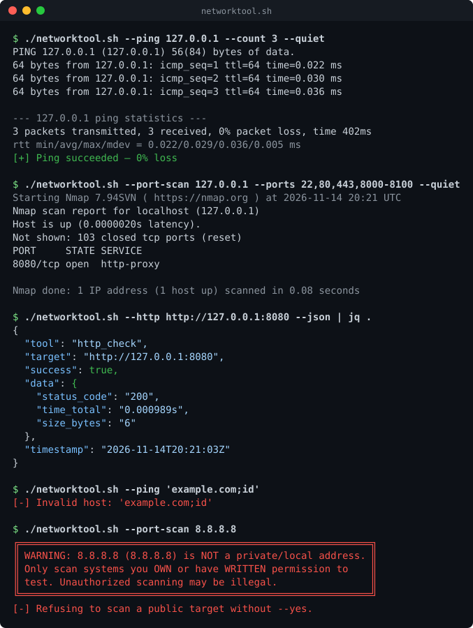

# Network Tool Pro

[](https://github.com/CMD126/Network_Tool/actions/workflows/ci.yml)


[](LICENSE)

**One Bash command for 20 everyday network checks (ping, DNS, port scans, TLS
certificates, HTTP headers, bandwidth) with an interactive menu for people and
a `--json` CLI for scripts and automation.**

### Why it matters

- **Faster troubleshooting.** Instead of remembering the right flags for
  `ping`, `dig`, `nmap`, `openssl`, `curl`, `ss` and friends on each OS, you
  pick a menu item or one flag and get a readable answer.
- **Automation-ready.** Every check is also a CLI flag; with `--json` stdout is
  one JSON object per result, so it can feed `jq`, monitoring or CI jobs.
- **Safe by default.** Every target is validated before it reaches a command,
  and scans of anything that is not a private/local address are refused
  unless you explicitly confirm (`--yes` or a `[y/N]` prompt).

### Demo



Real output, recorded with [`docs/demo.sh`](docs/demo.sh) against this machine
only (127.0.0.1 and a throwaway local web server) and rendered to SVG by
[`docs/render_svg.py`](docs/render_svg.py); the plain-text transcript is in
[`docs/demo.txt`](docs/demo.txt). The last two commands show the safety checks:
a shell-injection attempt is rejected as an invalid host, and a scan of a public
IP is refused before any packet is sent.

### Engineering highlights

- **Modular, cross-platform design:** ~2,600 lines of Bash split into `lib/`
  modules; OS differences (`ip` vs `ifconfig`, `ss` vs `netstat`, ping flags,
  `/sys` vs `netstat -ib`) live behind one abstraction layer
  ([lib/platform.sh](lib/platform.sh)).
- **Input handling written with an attacker in mind:** strict validators for
  IPs (v4/v6), domains, CIDRs, URLs, port lists and interface names; untrusted
  numbers are checked before they reach bash arithmetic (which would otherwise
  execute `$(...)` hidden in a value); targets are always passed as single
  quoted arguments, never through `eval`. See [SECURITY.md](SECURITY.md).
- **Tested contract:** 56 [bats](https://github.com/bats-core/bats-core) tests,
  including end-to-end checks that `--json` output parses as JSON and
  regression tests for each input-validation fix, seven Python XML-parser tests,
  plus a dependency-free
  fallback runner (`tests/run_tests.sh`).
- **CI on every push:** ShellCheck at warning level (zero warnings) and the
  full test suite on GitHub Actions.

### Quick start

```bash
git clone https://github.com/CMD126/Network_Tool.git
cd Network_Tool
./networktool.sh                          # interactive menu
./networktool.sh --ping 127.0.0.1 --json  # one check, machine-readable
./networktool.sh --help                   # every flag, with examples
```

## Features

| Category | Capabilities |
|----------|-------------|
| **Quick** | Dashboard, public IP, interface, gateway, DNS, connectivity (parallel-pinged) and open ports at a glance |
| **Network** | Interface info, routing table, ARP, local host discovery |
| **Connectivity** | Ping, traceroute, MTU discovery |
| **DNS** | Full record lookup (A/AAAA/MX/NS/TXT), reverse DNS, whois |
| **Scanning** | Port scan, service/OS version scan, vulnerability check (NSE) |
| **Web & TLS** | HTTP headers/stats, SSL certificate expiry + SANs, IP geolocation |
| **Monitoring** | Active connections, listening ports, speed test, live bandwidth (real-time) |

## What's new in v4.0

- **Cross-platform**: every OS-specific command (`ip` vs `ifconfig`/`route`,
  `ss` vs `netstat`/`lsof`, `/sys/class/net` vs `netstat -ib`, ping flags,
  MTU/DF-bit probing, …) is abstracted behind [lib/platform.sh](lib/platform.sh)
  so the same feature code serves Linux and macOS/BSD. CI runs on Ubuntu; the
  macOS/BSD branches are not exercised by CI.
- **CLI / headless mode**: every menu item is also a flag, see
  [CLI usage](#cli-non-interactive-usage) below. `--json` gives structured,
  `jq`-pipeable output; `--quiet` trims human output to the essentials.
- **Security hardening**: `sanitize_input()` strips shell metacharacters,
  `validate_ip/domain/cidr/url/port_range/iface()` reject malformed targets
  before they ever reach a command, config values are validated before use,
  and port/vuln scans refuse to touch a
  non-private address without an explicit `--yes` (or interactive
  confirmation), printing a loud legal-use warning first.
- **Reliability fixes**: parallel dashboard pings (background jobs + `wait`),
  a `check_connectivity()` pre-flight before speed tests, safe numeric
  handling in the speed test (no more crashing on a malformed/empty curl
  result), and live-bandwidth counter-wrap detection instead of printing
  bogus negative rates.
- **Config file** at `~/.config/networktool/config.ini` for default ping
  count, ports, timeout, color, DNS server, log rotation limits, and
  speed-test endpoints.
- **Target history**: the last 10 targets you type are remembered
  (`~/.config/networktool/history`); type `h` at any prompt to see them.
- **Log rotation**: the log is trimmed to the last 1000 lines / 5 MB,
  whichever comes first.
- **Bug fixes** carried over from the v3.0 code (see [Bug fixes](#bug-fixes-from-v30) below).

## Requirements

### Essential

- `bash` 4+ (macOS ships bash 3.2 by default, most of this script works fine
  there too, but `brew install bash` is recommended)
- `curl`
- `openssl`
- `ping`
- Linux: `ip` (iproute2), `ss` (iproute2)
- macOS/BSD: `ifconfig`, `netstat`, `route` (all present by default)

### Optional (for full functionality)

- `nmap`, port scan, service scan, vuln check, local discovery
- `traceroute` or `tracepath`, hop-by-hop path
- `dig` / `nslookup` / `host`, DNS lookups (at least one required)
- `whois`, domain/IP registration info (falls back to an RDAP HTTP lookup)
- `python3`, required for the NSE vulnerability check XML parser; also improves
  geolocation/RDAP JSON formatting (those checks have a fallback)
- `lsof`, process names in listening-port/connection lists on macOS/BSD
- GNU coreutils `timeout`/`gtimeout`, bounds the SSL check; the tool still
  works without it, just without a hard timeout

## Installation

```bash
# Clone
git clone https://github.com/CMD126/Network_Tool.git
cd Network_Tool

# Debian/Ubuntu
sudo apt install nmap traceroute dnsutils iproute2 curl whois openssl python3

# RHEL/CentOS
sudo yum install nmap traceroute bind-utils iproute curl whois openssl python3

# macOS (Homebrew)
brew install nmap whois bash coreutils
```

Run it in place:

```bash
./networktool.sh              # interactive menu
sudo ./networktool.sh         # root: enables SYN scans + OS detection
```

### `make install` (optional)

Installs the script + `lib/` under a prefix and adds a `networktool` command
to your `PATH`, plus a default config file:

```bash
make install                        # installs to /usr/local (needs sudo)
make install PREFIX=$HOME/.local    # per-user install, no sudo
make uninstall
make test                           # run the test suite (bats-core if present, else a plain-shell fallback)
make lint                           # shellcheck, if installed
```

## Usage

### Interactive (TUI)

```bash
./networktool.sh
```

Type a menu number, `help` for usage/examples, or `h` at any target prompt
to pick from your last 10 targets.

### CLI (non-interactive) usage

Every feature is scriptable:

```bash
./networktool.sh --dashboard
./networktool.sh --ping 8.8.8.8 --count 10
./networktool.sh --traceroute example.com
./networktool.sh --mtu 8.8.8.8
./networktool.sh --dns google.com
./networktool.sh --reverse-dns 8.8.8.8
./networktool.sh --whois example.com
./networktool.sh --port-scan 192.168.1.1 --ports 22,80,443
./networktool.sh --service-scan 192.168.1.1 --ports 1-1000
./networktool.sh --vuln-check 192.168.1.1 --yes
./networktool.sh --http https://example.com --json
./networktool.sh --ssl example.com --port 443
./networktool.sh --geolocate 8.8.8.8
./networktool.sh --interfaces
./networktool.sh --routes
./networktool.sh --discover 192.168.1.0/24
./networktool.sh --connections
./networktool.sh --listening
./networktool.sh --speed-test --quiet
./networktool.sh --live-bandwidth eth0 --samples 5
```

Global flags: `--json`, `--quiet`, `--no-color`, `--count N`, `--ports RANGE`,
`--port N`, `--samples N`, `--interval N`, `--yes`, `-h`/`--help`.

`--vuln-check` and a non-private `--port-scan`/`--service-scan` target always
require explicit consent, interactively via a `[y/N]` prompt, or in CLI mode
via `--yes`. Without it the scan is refused.

The vulnerability check counts structured NSE `state` values of `VULNERABLE`
or `LIKELY VULNERABLE`, one finding per structured vulnerability table. Text-only scripts
without structured states remain visible in the scan output but are not counted.
This is a count of NSE reports, not unique CVEs or independently verified
exploitability. A successful zero count does not establish that a host is secure.
Nmap failures, incomplete runs and malformed XML return an error, not a clean
zero-finding result.

#### JSON output

Real output (from [docs/demo.txt](docs/demo.txt)):

```bash
$ ./networktool.sh --http http://127.0.0.1:8080 --json | jq .
{
  "tool": "http_check",
  "target": "http://127.0.0.1:8080",
  "success": true,
  "data": {
    "status_code": "200",
    "time_total": "0.000989s",
    "size_bytes": "6"
  },
  "timestamp": "2026-11-14T20:21:03Z"
}
```

Each result is one JSON object on its own line:
`{"tool", "target", "success", "data", "timestamp"}`. Most checks print one
object; `--live-bandwidth` prints one per sample. Under `--json`, stdout carries
only JSON (raw tool output is suppressed), errors go to stderr, and an invalid
target exits with status 1.

## Menu Reference

| # | Function | Description |
|---|----------|-------------|
| **1** | Dashboard | Public IP, primary interface, gateway, DNS servers, connectivity to 8.8.8.8/1.1.1.1/google.com (pinged in parallel), top open ports |
| **2** | Interface Info | All interfaces, IP, MAC, state (UP/DOWN), RX/TX byte stats |
| **3** | Routing Table | Default gateway, full route table, ARP/neighbour cache |
| **4** | Local Discovery | nmap ping sweep of a subnet to find live hosts and MACs |
| **5** | Ping | ICMP test with configurable packet count |
| **6** | Traceroute | Hop-by-hop path (falls back to `tracepath`) |
| **7** | MTU Discovery | Probes common MTU sizes (1500 → 576) with DF-bit ping |
| **8** | DNS Lookup | A, AAAA, MX, NS, TXT records + configured DNS servers |
| **9** | Reverse DNS | PTR lookup for any IP |
| **10** | Whois | Domain/IP registration (falls back to an RDAP HTTP lookup if `whois` isn't installed) |
| **11** | Port Scan | Open ports via nmap (SYN as root, TCP connect as user); warns/blocks on non-private targets |
| **12** | Service Scan | Service versions + OS detection |
| **13** | Vuln Check | nmap NSE `vuln,auth,default` scripts, always requires explicit consent |
| **14** | HTTP Check | Status code, response headers, redirect chain, timing, speed |
| **15** | SSL Certificate | Expiry countdown, issuer, Subject Alternative Names, cipher suite |
| **16** | IP Geolocation | Country, city, ASN, org, timezone via ipinfo.io |
| **17** | Active Connections | All established TCP/UDP sessions with process names (where available) |
| **18** | Listening Ports | Services bound and waiting, TCP + UDP |
| **19** | Speed Test | Download bandwidth in Mbps, with a connectivity pre-check |
| **20** | Live Bandwidth | Real-time RX/TX bytes/s and Kbps per interface, wrap-safe |
| **21** | View Log | Last 30 entries from `networktool.log` |
| **22** | Export Result | Save any previous result (by index) to `last_result.txt` |
| **0** | Exit | |

## Configuration

Config file: `~/.config/networktool/config.ini` (written automatically on
first run from [config/config.ini.example](config/config.ini.example)).

| Key | Default | Description |
|-----|---------|-------------|
| `ping_count` | `4` | Default ping packet count |
| `ports` | `1-1000` | Default port range for scans |
| `timeout` | `10` | Seconds before SSL/whois calls time out |
| `color` | `on` | Set `off` to disable ANSI colors |
| `colorblind_safe` | `off` | Reserved, `+`/`-`/`!`/`*` symbols are already always shown alongside color |
| `dns_server` | *(empty)* | Informational preferred DNS server note |
| `log_max_size` | `5242880` | Log rotation size threshold (bytes) |
| `log_max_lines` | `1000` | Log rotation line-count threshold |
| `speed_test_endpoints` | Hetzner/Bouygues mirrors | Comma-separated direct-download URLs |

CLI flags always override the config file; the config file always overrides
the built-in defaults.

## Common Workflows

### Quick network health check
```
1 → Dashboard
```

### Troubleshoot connectivity
```
5 → Ping gateway
6 → Traceroute to failing host
8 → Verify DNS resolves correctly
```

### Inspect a server
```
11 → Port scan
12 → Service/OS fingerprint
15 → Check SSL cert expiry
14 → Inspect HTTP headers
```

### Monitor live traffic
```
20 → Live bandwidth on primary interface
17 → Active connections
18 → Listening ports
```

## Project layout

```
networktool.sh        Entry point: sourcing, setup/cleanup, menu loop, CLI dispatch
lib/utils.sh           OS detection, validation/sanitization, logging+rotation, config, history, JSON, spinner
lib/ui.sh               Colors, symbols, banner, menu, prompts, help text
lib/platform.sh         Cross-platform command abstraction (Linux vs macOS/BSD)
lib/output.sh            Result stack, view log, export result
lib/network.sh           Dashboard, interfaces, routes, discovery, ping, traceroute, MTU
lib/dns.sh               DNS lookup, reverse DNS, whois
lib/scan.sh              Port scan, service scan, vuln check
lib/web.sh               HTTP check, SSL certificate, geolocation
lib/monitor.sh           Connections, listening ports, speed test, live bandwidth
lib/cli.sh               Non-interactive argument parsing & dispatch
config/config.ini.example
tests/test_utils.bats   Unit tests: validators, sanitizer, JSON helpers
tests/test_security.bats  Regression tests for input-handling hardening
tests/test_cli.bats     End-to-end CLI tests (JSON contract, rejected input)
tests/test_web.bats     Certificate date parsing
tests/test_scan.bats    Offline NSE CLI regressions
tests/test_nse_findings.py Structured XML parser regressions
tests/run_tests.sh      Fallback runner when bats is not installed
docs/                   Demo recording script, transcript and SVG
Makefile
```

## Bug fixes from v3.0

- **`dns_lookup()`**: `dig`'s positional syntax is `dig NAME TYPE`, not
  `dig TYPE NAME`, the old code silently returned nothing.
- **`whois_lookup()` RDAP fallback**: the domain was mangled (`.` → `DOT`)
  before being sent to `rdap.org`, which meant the fallback could never
  succeed; the real domain is now passed through (and redirects are followed).
- **`trace_route()`**: now captures the output of whichever tool actually
  ran (`traceroute` or `tracepath`) instead of unconditionally re-running
  `traceroute`.
- **`speed_test()`**: validates the curl-reported speed is a well-formed
  number before comparing it in `awk`, instead of crashing on an
  empty/malformed result.
- **`ssl_cert()` expiry parsing**: handles both GNU `date -d` and BSD/macOS
  `date -j -f`, and openssl's double-space-padded single-digit day
  (`"Jun  1 ..."`), which used to break the naive BSD format string.
- **`interface_info()` stats**: the `ip -s link` parser no longer assumes a
  fixed number of lines between RX/TX headers and their values.

## Notes

- **Legal**: Only scan hosts and networks you own or have explicit written
  permission to test. Port scans and vuln checks against a non-private
  address print a loud warning and require explicit consent (`--yes` in CLI
  mode).
- **Root**: Required for SYN scans (`-sS`) and OS detection. Non-root falls
  back to TCP connect scans.
- **Logs**: `networktool.log` records actions with timestamps and rotates
  automatically. May contain target hostnames/IPs, handle accordingly.
- **Temp files**: created via `mktemp -d` and cleaned up automatically on exit.
- **Shell strictness**: the script runs under `set -uo pipefail`, not `-e` -
  see the comment at the top of `networktool.sh` for why (a normal "no match"
  `grep`/`dig` result is expected, not an error, and would otherwise abort
  the whole run).

## Version History

| Version | Changes |
|---------|---------|
| 4.0 | Cross-platform (Linux/macOS/BSD) rewrite, modular `lib/`, CLI + JSON mode, config file, input validation/sanitization, target history, log rotation, parallel dashboard pings, bug fixes (see above), test suite |
| 3.0 | Full rewrite, 22-function daily-use suite with TLS, geolocation, live bandwidth, MTU, vuln check |
| 2.1 | Bug fixes, dig syntax, speed test endpoints, ip -color, log path, MTU, scan quoting |
| 2.0 | Enhanced features, improved logging, better error handling |
| 1.0 | Initial release |

## Author

Created by [@lexlucas](https://github.com/CMD126)

## License

[MIT](LICENSE). Intended for legitimate diagnostics and authorized testing;
users are responsible for complying with all applicable laws and regulations.

> **Disclaimer**: Use this tool responsibly and only on networks you own or
> have explicit permission to test. Unauthorized scanning may be illegal in
> your jurisdiction.
